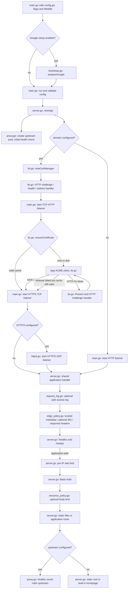
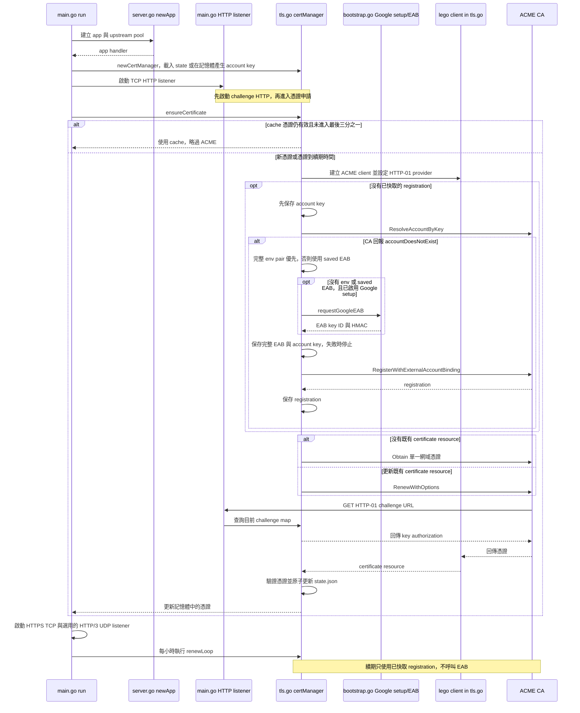
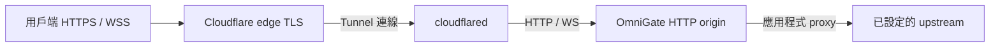

# 架構

本文件依目前的 Go 實作描述啟動、請求、ACME 和持久狀態的流向。設定與部署範例見 [config/README.md](../config/README.md)；使用者規格見 [specs.md](specs.md)。

## 原始碼責任

| 檔案 | 責任 |
| --- | --- |
| [`main.go`](../main.go) | 定義設定結構、檢查值、呼叫 CLI parser、建立 listeners、執行 graceful shutdown，並在啟動時選擇 Google setup。HTTP listener 在取得憑證前啟動。 |
| [`config.go`](../config.go) | 提供預設值，解析旗標及單站台 Webfile，並讓明確指定的 CLI 旗標覆蓋檔案值。 |
| [`server.go`](../server.go) | 建立應用程式 handler，處理健康端點、靜態檔案、內建首頁、Basic Auth 與 per-IP limiter，並組合 hardening middleware。 |
| [`proxy.go`](../proxy.go) | 驗證 upstream URL、建立 reverse proxy、執行健康檢查，並在健康 upstream 間輪替選取。 |
| [`tls.go`](../tls.go) | 載入及驗證 ACME cache，建立 ACME 帳戶、執行 HTTP-01、申請或更新憑證、原子寫入狀態，並提供憑證給 TLS listener。 |
| [`http3.go`](../http3.go) | 建立 QUIC HTTP/3 server，使用 TLS 設定及應用程式 handler；停用 0-RTT。 |
| [`bootstrap.go`](../bootstrap.go) | 執行 Google Cloud CLI 安裝或解析、互動登入、專案選擇、Public CA API 啟用及 EAB 取得。 |
| [`edge_policy.go`](../edge_policy.go) | 驗證 trusted peer forwarded metadata，產生 canonical HTTPS 301，並套用 response cache、安全 header。 |
| [`resource_policy.go`](../resource_policy.go) | 在認證後限制應用 request body；串流超限映射為 413。 |
| [`request_log.go`](../request_log.go) | 選用安全 request completion log 與自產 request ID，保留 response writer 的串流／hijack 能力。 |

## 啟動與請求流程

`newApp` 建立池後會先同步檢查 upstream，再啟動週期檢查。每個健康檢查以 GET 請求組合出的 health URL，逾時為兩秒；只有 2xx 才算健康。`pick` 從目前輪替位置開始掃描所有 upstream，選第一個健康者，再將下一次選取位置前移。若沒有健康 upstream，普通請求與 readiness 回 503。代理請求錯誤會回 502；request context 仍有效時，該 upstream 也會標為不健康。服務不重試同一個應用程式請求，以免重送可能已到達後端的 POST。

`observeRequests` 可選地包在應用 handler 外側，因此記錄 redirect、health、401、429 與應用 response。`edge_policy.go` 以 socket peer 比對 `trusted_proxies`；只有可信 peer 的單一合法 `X-Forwarded-Proto` 可改變 HTTP origin scheme，direct TLS 優先，缺漏或無效值沿用 HTTP。固定 `public_url` 避免由 request `Host` 產生 Location。若啟用 `https_redirect`，解析後為 HTTP 的應用路徑在限流與 Basic Auth 前回 301，health path 例外。接著 health 直接回應；其他路徑經過 limiter、Basic Auth、可選 body cap 與應用路由。成功認證後，`server.go` 移除 `Authorization` 再呼叫應用程式路由。

`edge_policy.go` 的 `private_cache` 可將應用 response 與 health response 設為 `private, no-store`，清除 origin 的 shared cache headers。它不能移除 Cloudflare 已有 cache HIT。`request_log.go` 不記 path、query、Authorization、Cookie、body 或 username；記錄的 `origin_scheme` 僅由 Go 收到請求時的 TLS／明文 transport 判定，不反映 Cloudflare 的 client-facing HTTPS 或 forwarded scheme。`resource_policy.go` 對已知超限長度預先回 413，對未知長度串流限制可能已將部分 bytes 送到 handler 或 upstream。

## HTTP、TLS 與 HTTP/3

`main.go` 在 TLS 模式下先以 `tls.go` 的 `httpHandler` 建立 HTTP listener。這個 handler 先回覆有效的 HTTP-01 challenge，再讓健康端點通過，接著驗證 Host；其他有效網域的路徑回 308 HTTPS redirect。網域不符時回 421。它只包在 HTTP listener 外層，不包 HTTPS 或 HTTP/3 handler。

憑證可用後，HTTPS listener 使用 `tls.Config.GetCertificate` 取得 cache 中的憑證，最低 TLS 版本為 1.2。啟用 HTTP/3 時，`http3.go` 用同一 TLS 設定的 clone 建立 QUIC server，並把同一個 `app` handler 交給 HTTP/3。HTTPS TCP handler 會額外寫入 Alt-Svc 標頭；HTTP/3 handler 不使用這個 HTTPS 廣告包裝器。QUIC 0-RTT 關閉，以避免可重播的應用程式請求。

HTTP/3 UDP port 必須由防火牆或雲端網路規則允許。HTTP-01 驗證仍需公用 TCP 80，即使使用非標準 HTTP、HTTPS 或 HTTP/3 port。WebSocket 依 HTTP/1.1 Upgrade 代理，沒有 HTTP/3 extended CONNECT 支援。

## Google setup、ACME 與 EAB

`main.go` 只在 `-setup-google` 或 `google_setup on` 時呼叫 `prepareGoogle`。`bootstrap.go` 先收集缺少的網域與信箱，然後檢查符合設定的 ACME cache。如果 cache 有匹配的 ACME registration，setup 將 TOS 標記為已接受並略過 gcloud 安裝、初始化、專案清單及 API 變更。否則，互動流程要求接受 TOS；必要時詢問是否把官方 Google Cloud CLI 安裝到使用者家目錄下的 `.local/share/google-cloud-sdk`。程式檢查 local active login，已有登入時跳過 init，沒有登入時才執行互動 init，之後列出並確認專案、確認啟用 `publicca.googleapis.com`。流程不會授予 IAM 權限。

第一次 ACME 註冊需要 EAB，且目前所有新 registration 都呼叫 EAB 註冊流程。`tls.go` 先用持久帳戶私鑰呼叫 `ResolveAccountByKey`，避免重複建立已存在的帳戶。只有 CA 回報帳戶不存在時才走新註冊。完整 `GOOGLE_ACME_EAB_KID`／`GOOGLE_ACME_EAB_HMAC` 優先，兩者皆未設定時使用 saved EAB；沒有 saved pair 且 Google setup 已配置時，才由 `bootstrap.go` 用所選專案呼叫 gcloud 取得 EAB。Partial env pair 直接拒絕，不混合 credential 來源。完整 EAB 與 account key 先原子保存再註冊。自訂 ACME directory 須提供該 CA 的 EAB，Google setup 只支援 Google production 和 staging。EAB 只供新註冊使用，不在續期流程重新取得或送出。

### ACME 申請與更新序列

新申請與續期都會在 HTTP listener 已可接收請求後執行 HTTP-01。ACME provider 的 `Present` 將 token 與 key authorization 放入記憶體 map，HTTP challenge handler 以 Host 和 challenge path 查找，`CleanUp` 在流程結束時刪除項目。憑證存入 cache 並驗證目前有效後，`GetCertificate` 才向 HTTPS/HTTP/3 提供它。

## 持久狀態

`tls.go` 在 `cert_dir/state.json` 保存 ACME directory、domain、email、帳戶私鑰、registration、certificate resource、憑證與憑證私鑰，以及新註冊使用的完整 EAB。EAB 是短效、單次註冊憑證，保留它不能替代 account key，既有帳戶依 saved key 恢復。讀取既有狀態時，directory、domain、email 必須完全符合目前設定；不符合就拒絕啟動，要求改用相符的 `cert_dir`。舊狀態沒有 EAB 仍可讀。程式將狀態序列化到同目錄的暫存檔，設定檔案權限為 `0600`、寫入並同步後以 rename 取代 `state.json`。新目錄使用 `0700` 建立。

程序會在啟動時檢查憑證；若尚未進入憑證有效期最後三分之一，跳過申請。進入該區間後更新憑證，之後每小時檢查一次。更新失敗時會保留並繼續使用仍有效的 cache 憑證，每小時重試。初次申請失敗且沒有可用 cache 時，服務不會開啟 TLS listener；有可用憑證時會記錄警告並以 cache 啟動。

目前沒有跨程序鎖或熱載入。備份 `state.json` 等同備份 ACME 帳戶與 TLS 私鑰，必須以私有資料方式保管。

## Cloudflare Tunnel

[`cloudflared-example.Webfile`](../config/cloudflared-example.Webfile) 示範 HTTP-only origin、固定 `public_url`、可信 proxy metadata、private no-store、HSTS、frame／referrer headers 與安全 access log。使用前請替換 hostname、upstream 和可信 peer CIDR。此範例不是已驗收的部署設定。

Cloudflare edge HTTPS rule、cache bypass 或 purge，與 OmniGate origin 設定分開處理。`private_cache` 無法移除已由 edge cache 提供的 object。`max_body_bytes 0` 不限制 request body；請先確認應用程式上傳政策，再設定明確上限。

Google ACME 的 HTTP-01 是另一種部署方式，需要公用 TCP 80 可到達 challenge listener。TLS-terminating tunnel 後的 HTTP-only origin 不會使用此流程。設定 HTTP/3 listener 時使用 UDP 上的 QUIC；Cloudflare edge HTTP/3 不代表 OmniGate 已啟用 QUIC。

使用隔離 upstream 和每次更新的唯一 marker 測試 tunnel 路由。Fixture 的 WebSocket echo 只驗證 fixture 與 OmniGate proxy，不代表其他應用程式的 endpoint。Health response 不能證明公網路由身分。驗收步驟見 [production deployment](production.md)。

OmniGate 不會 hot-reload Webfile。服務重新啟動可能中斷已升級的 WebSocket 連線，因為 HTTP shutdown 不會排空這些連線。Tunnel restart、Cloudflare rule 變更、cache bypass 或 purge 都需分別授權及驗證。