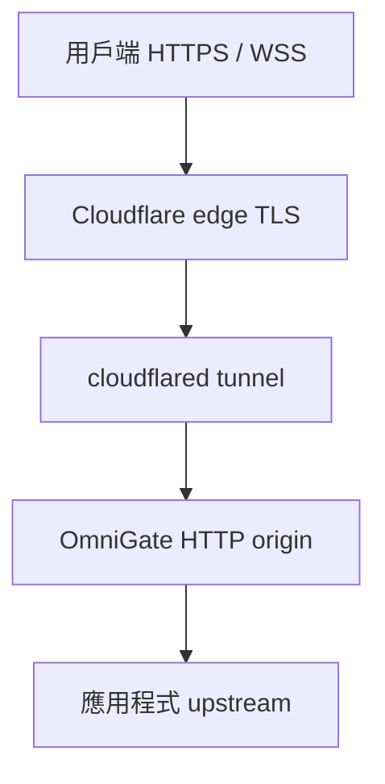

# Production 部署

本文件說明 OmniGate 部署時需注意的事項。本機建置成功不代表已完成 production soak、公網路由或真實憑證簽發。請只在私密設定中使用部署專用的 hostname、upstream、port 與密碼。

## 範例拓撲



Tunnel 內部協定與公開 HTTPS 連線不同。若 Cloudflare 終止公開 TLS，公開 HTTPS／WSS 憑證由 edge 提供；這不會驗證 OmniGate 的 Google ACME 憑證流程或 HTTP/3 listener。請分別設定與驗證 edge、connector、origin 及應用程式各層。

HTTP-only origin 可使用 `https_redirect on` 及固定 `public_url`。OmniGate 只信任來自 `trusted_proxies` 範圍內 socket peer 的單一合法 `X-Forwarded-Proto`。若 connector 無法可靠提供 scheme header，請關閉 origin redirect，改用明確限定 hostname 的 edge redirect。Cloudflare edge rule 在 request 到 origin 前執行，與 OmniGate redirect 分開處理。

## Artifact 與設定

macOS arm64 release artifact 名稱為 `dist/omnigate-darwin-arm64`。Artifact 大小依 build 而異，此處不列出目前大小。[`config/`](../config/README.md) 內的公開 Webfile 是範例，不是可直接部署的私密設定。

- [Cloudflare Tunnel 範例](../config/cloudflared-example.Webfile)：使用前請替換 canonical URL、upstream 與可信 peer CIDR。
- [Google ACME 範例](../config/production-example.Webfile)：使用前請替換 hostname、ACME email 與 project ID。Google setup 可能執行 gcloud、API 或 EAB 操作。
- 密碼、EAB、帳戶私鑰、憑證私鑰與部署專用 Webfile 不應存放於公開版本控制。
- `cert_dir/state.json` 含 ACME 帳戶與憑證機密。請以私密憑證資料保護該目錄及備份。

舊 build 記錄中的 9.88 MiB 是先前 artifact 的大小，不是 v0.1.0 artifact 的目前大小，不應當作目前產物大小使用。

## 建置

使用 source 指定的 Go 版本與 module requirements。以下命令編譯 macOS arm64 artifact：

```sh
mkdir -p dist
mise exec go@1.27.1 -- env CGO_ENABLED=0 GOOS=darwin GOARCH=arm64 \
  go build -trimpath -buildvcs=false -ldflags='-s -w' \
  -o dist/omnigate-darwin-arm64 .
```

這是 macOS arm64 binary，不是 Linux binary。命令會移除 build path、symbol／debug 資料及 VCS metadata，不會修改 Go runtime 預設值。散布自行建置的 artifact 時，請記錄 Go 版本、build 命令、source revision 與該檔案的 checksum。新 build 不可沿用歷史 checksum。

## HTTP-only origin 設定

使用 Cloudflare 公開 Webfile 前，請先檢查並替換範例值。設定 connector 將自己管理的 hostname 轉送至 origin。需要時使用 hostname-scoped rule，不要將範例 hostname 或 zone-wide policy 套用至其他網域。

首次部署時，先從 repository root 將公開範本複製到私密設定檔。若目標已存在，請勿覆寫；檢查並使用現有檔案。

```sh
if [ -e config/production.Webfile ]; then
  printf 'config/production.Webfile already exists; refusing to overwrite\n' >&2
  exit 1
fi
cp config/cloudflared-example.Webfile config/production.Webfile
chmod 600 config/production.Webfile
```

編輯 `config/production.Webfile`，替換 canonical URL、upstream 與可信 peer CIDR。此私密檔案不應提交版本控制。

互動讀入 Basic Auth 密碼，避免密碼進入 command arguments 或 shell history：

```sh
printf 'Basic Auth password: '
read -r -s WEB_HTTP_AUTH_PASSWORD
printf '\n'
export WEB_HTTP_AUTH_PASSWORD
./dist/omnigate-darwin-arm64 -config config/production.Webfile
```

只有確認 origin socket peer 位於 trusted CIDR，且 connector 行為已驗證後，才能信任 forwarded metadata。不要因本機測試可設定該 header，就假設 Cloudflare 已提供、覆寫或驗證它。

Tunnel ingress 可使用以下通用 origin 範例：

```yaml
ingress:
  - hostname: example.com
    service: http://127.0.0.1:8081
  - service: http_status:404
```

請將 `example.com` 換成自己管理的 hostname，並分別設定 DNS 與 tunnel routing。Connector 設定變更不一定會自動套用到執行中的程序。Tunnel restart 可能中斷流量，僅由 tunnel 管理者安排並驗證路由。不要將 credential JSON 公開，也不要在公開文件加入真實 tunnel ID。

檢查影響並取得授權後，可用管理者設定的值啟動 tunnel：

```sh
: "${TUNNEL_ID:?set TUNNEL_ID for your own tunnel}"
: "${CLOUDFLARED_CONFIG:?set CLOUDFLARED_CONFIG to your connector config}"
cloudflared tunnel --config "$CLOUDFLARED_CONFIG" --protocol http2 run "$TUNNEL_ID"
```

## 驗收

使用隔離 upstream 分別檢查各層：

1. 從 OmniGate 所在主機檢查 origin 的 `/healthz` 與 `/readyz`。
2. 直接檢查應用程式 upstream，再經 OmniGate 檢查。OmniGate health response 本身不代表 upstream 應用程式路由正常。
3. 使用隔離 upstream 測試 authentication、rate limiting、redirect 與 WebSocket frames。
4. 只對自己管理的網域和 tunnel 驗證公網 HTTPS、WSS、forwarded metadata 與 cache 行為。本機 fixture 或加入 `X-Forwarded-Proto` 的 helper 不能證明執行中的 connector 會送出該 header。
5. 記錄實際執行與未執行的檢查。Local smoke test、fixture response 或 connector config parse 都不能證明公網流量路由正確。

Origin 的 `private, no-store` response 無法使 Cloudflare 已快取的 object 失效。需要時使用明確 scoped 的 Cache Rule bypass。任何 purge 都須由具權限的 zone 管理者授權，並將範圍限制到必要範圍。Edge redirect、bypass rule 與 purge 都需分別驗證。

`max_body_bytes 0` 不限制 request body。請先確認應用程式上傳政策，再設定正值。Chunked 或其他未知長度的 body 可能已有部分內容送到 handler 或 upstream，OmniGate 才偵測到超限。

工具見 [scripts/README.md](../scripts/README.md)；Cloudflare edge redirect 與 cache 操作見 [Cloudflare 指引](cloudflare.md)。

## Google ACME

Google ACME 是獨立於 Cloudflare TLS termination 後 HTTP-only origin 的另一種部署方式。HTTP-01 需要公用 TCP port 80 可到達設定的 challenge listener。HTTPS 與選用的 HTTP/3 也需要正確設定 TCP 與 UDP routing。

首次 Google setup 可能要求互動式 gcloud login、選擇 project、啟用 Public CA API 及建立 EAB。請逐一檢查提示，並使用有權執行這些操作的帳戶。OmniGate 不會授予 IAM 權限。EAB 與帳戶狀態需保密；ACME 帳戶註冊後，續期會使用保存的 account key 與 registration。

v0.1.0 未驗證真實 Google login、project／API 變更、EAB request 或憑證簽發。Mock tests 不能證明這些外部操作成功。

## 歷史驗證紀錄

以下紀錄保留原本檔名，記錄較早 build 或隔離測試。它們不代表 v0.1.0 artifact、目前 Cloudflare deployment 或公網 routing 已驗證：

- [較早的 production 驗證紀錄](../reports/production-verification.json)
- [較早的 origin-routing 紀錄](../reports/2026-10-09-origin-routing.json)
- [2026-10-09 hardening 紀錄](../reports/2026-10-09-hardening.json)
- [歷史 HTTP 負載測試與 charts](../reports/2026-10-08-load-test.md)

這些紀錄內的 checksum 與 artifact 資訊只識別原始檔案，是歷史證據，不代表重新命名後的 `dist/omnigate-darwin-arm64` artifact。本文件不宣稱 v0.1.0 已執行新的壓力測試或公網部署驗證。
