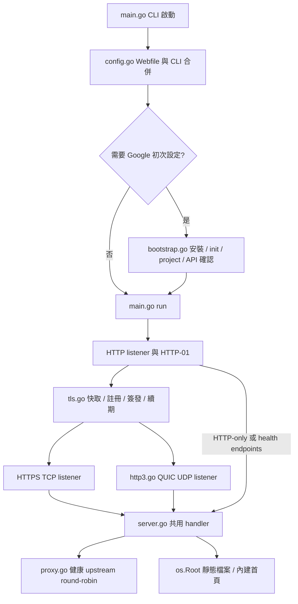

# Web server 開發計畫與實作紀錄

## 需求

建立 Go HTTP／HTTPS server，提供 Basic Auth、預設 rate limit、reverse proxy、多 upstream 健康檢查與 round-robin、靜態檔案及內建首頁。HTTPS 使用 Google Trust Services ACME，支援 EAB 與自動續期。

後續需求包括 Google Cloud CLI 自動安裝與互動式 init、讓使用者選擇 project 並申請 SSL、QUIC／HTTP/3、自訂 port、類似 Caddyfile 的設定，以及 WS／WSS。另需評估記憶體、效能及穩定性，不預設優於 Caddy、Nginx、Ferron 或 Pingora。

本次紀錄包含 specs、架構、README、維護、debug、`config/` 範例、負載測試原始資料與圖片。

## 範圍與決策

- 使用 Go 1.27.1。`go.mod` 記錄最低工具鏈版本。
- HTTP、middleware、檔案與 reverse proxy 以 Go 標準函式庫為主。
- ACME 使用 `github.com/go-acme/lego/v4`；HTTP/3 使用 `github.com/quic-go/quic-go`；token bucket 使用 `golang.org/x/time/rate`。
- 保留 CLI 用法。`-config` 載入單站 Webfile，明確提供的 CLI flag 覆蓋檔案。
- 一個程序服務一個 DNS 網域，一個 `cert-dir` 只供一個程序使用。
- Basic Auth 與 EAB 使用環境變數或互動流程，不把 EAB 寫入公開設定或 log。後續 production 需求明確要求保存 EAB，因此完整 EAB 與 account key 原子保存至私密 `cert_dir/state.json`；這覆寫本次開發前段「不保存 EAB」決策，詳見 [production-eab.md](production-eab.md)。
- gcloud 已存在時重用；否則取得使用者同意後，安裝到使用者自己的 `~/.local/share/google-cloud-sdk`。不修改 shell profile，不自動安裝 Python、不授予 IAM 權限。
- 使用者選擇並確認 project，再確認啟用 `publicca.googleapis.com`。production／staging endpoint 以每次命令的環境指定，不修改全域 endpoint。
- HTTP-01 listener 在首次申請憑證前啟動。公網 TCP 80 必須可達，即使 HTTPS 使用自訂 port。
- 已註冊的帳戶從快取恢復，續期不需要 gcloud 或再次申請 EAB。每小時檢查一次，進入憑證有效期最後三分之一時續期。
- 續期失敗時保留仍有效的憑證；已過期的憑證不能繼續接受 TLS 連線。
- HTTP/3 使用獨立 UDP listener，但共用應用 handler 與可熱換的 TLS 憑證。HTTPS 回應用 Alt-Svc 廣告 UDP port。停用 QUIC 0-RTT，避免應用請求重放。
- WS／WSS 使用 HTTP/1.1 Upgrade。upstream 的 `ws://`／`wss://` 對應 `http://`／`https://`。不宣稱支援 HTTP/3 WebSocket extended CONNECT。
- 不自動重送失敗的 proxy 請求，避免 POST 重複執行。

## 實作流程

## 交付檔案

| 類型 | 位置 |
|---|---|
| 實作 | `main.go`、`config.go`、`server.go`、`proxy.go`、`tls.go`、`bootstrap.go`、`http3.go` |
| 單元／整合／競態測試 | 根目錄 `*_test.go` |
| 開發規格 | [docs/specs.md](../docs/specs.md) |
| 架構 | [docs/architecture.md](../docs/architecture.md) |
| 快速開始與特色 | [README.md](../README.md) |
| 維護與 debug | [docs/maintenance.md](../docs/maintenance.md)、[docs/debug.md](../docs/debug.md) |
| 設定範例 | [config/README.md](../config/README.md) |
| 測試工具 | `scripts/load_test.py`、`scripts/render_charts.py` |
| 測試結果與圖片 | [reports/2026-10-08-load-test.md](../reports/2026-10-08-load-test.md)、`reports/data/`、`reports/charts/` |

## 驗收狀態

- [x] HTTP、內建 HTML、靜態檔案、index、隱藏路徑、symlink 越界防護。
- [x] Basic Auth、credential 不轉送 upstream、peer IP 限流與 header spoofing 防護。
- [x] round-robin、upstream 故障排除與恢復、liveness／readiness。
- [x] 本機 ACME fixture 的 EAB、HTTP-01、CSR 簽發、續期、重啟及帳戶 key 恢復。
- [x] 真實 TLS、HTTP/2、QUIC／HTTP/3、自訂 port、Alt-Svc、憑證熱換與 shutdown。
- [x] WS／WSS 四種前後端 TLS 組合、101 handshake、雙向 frame、Basic Auth。
- [x] gcloud mock 的 project 選擇／取消、API scope、URL-safe EAB、log 隱私與 staging 隔離。
- [x] 官方 SDK archive 實際下載與安全解壓，未執行 installer。
- [x] Webfile parser、CLI 覆蓋、設定錯誤處理。
- [x] 互動式 Google setup 的 Ctrl-C 取消，包含實際 binary 測試。
- [x] `go test -race`、`go vet`、build 與 CLI smoke test。
- [x] handler benchmark 與 HTTP-only RSS 短測試。
- [x] README、specs、架構、維護、debug 與四份 `config/` 範例，全部範例解析／驗證通過。
- [x] 四階段可重跑 HTTP 負載測試、原始 JSON、build provenance、四張 SVG charts 與限制說明。

文件與本次負載測試的完成狀態，以 [測試報告](../reports/2026-10-08-load-test.md) 的命令、資料與限制為準。

## 已修正的 review 問題

1. Google `b64MacKey` 使用 URL-safe base64。申請流程正規化為 unpadded RawURL encoding，檢查 HMAC 至少 32 bytes。
2. `gcloud init` 使用原始 stdin，保留 terminal 行為；quiet installer 不讀取 stdin。
3. gcloud 命令停用 HTTP debug 與 file logging，避免 EAB 落入 log。
4. production endpoint 也明確覆蓋 persisted staging／custom gcloud 設定。
5. Google setup prompt 支援 context 取消，避免 signal handler 收到 Ctrl-C 後仍阻塞於 stdin。

## 尚未驗證與非目標

- 沒有執行真實 gcloud installer、登入、雲端 API 啟用或 Google 正式憑證簽發。這些流程需要使用者授權、網域、公網路由與 Google IAM 權限。
- 本次壓測不是跨產品比較，不足以宣稱比其他 server 快、省 RAM 或穩定。
- 尚未做長時間 soak、HTTP/3 高併發、WebSocket 大量長連線、故障注入與惡意流量測試。
- 沒有多站、config hot reload、HTTP cache、壓縮、access log／metrics、DNS-01 或 wildcard 憑證。
- 程序內限流不是多節點共享限流，也不限制 WebSocket 升級後的每個 frame。
- HTTP graceful shutdown 不會自動等待或關閉已 hijack 的 WebSocket。部署重啟會中斷長連線。

## 風險與回復

- 保留可用 binary、設定與私密 ACME 快取備份，升級失敗時用原版本及匹配設定恢復。
- 更換網域、email 或 CA directory 時使用獨立 `cert-dir`，不要刪除原本仍可用的 account key。
- 不提交帳戶私鑰、憑證私鑰、EAB、密碼、OAuth 資料或 gcloud 設定。
- 本目錄尚未初始化 Git。之後啟用版本控制時，應排除私密快取與本機設定，再提交程式、文件及經篩檢的測試結果。

## 專案 onboarding 與指令初始化

- Serena 專案 `web-http` 已啟用，使用 Go language server，並實際查詢 `main.go` 符號。
- `.serena/memories/` 已建立 `core`、`tech_stack`、`suggested_commands`、`conventions`、`task_completion`，遵守 `memory_maintenance` 的引用與維護契約。只保存專案規則與導覽，不保存對話、真實憑證或登入資料。
- [AGENTS.md](../AGENTS.md) 是專案指令來源，[CLAUDE.md](../CLAUDE.md) 透過 `@AGENTS.md` 共用規則。本次以建立這些文件完成 `/init` 的效果，沒有執行宿主的 slash command 或 `git init`。
- `.serena/project.yml` 排除憑證 cache、環境檔、key／PEM、Python cache、Serena cache、binary 與本機 `Webfile`。設定修改前已建立時間戳備份並驗證一致。
- `serena memories check` 已執行。它同時檢查全域記憶，回報一筆既有全域失效引用；本次沒有修改全域記憶。專案引用另外做完整性檢查。

## Production 與 EAB 保存

後續需求指定 `omni.curl.rs`、重用本機既有 gcloud 登入、保存產生的 EAB 並自動續期。變更範圍、恢復契約、驗證與狀態以 [production-eab.md](production-eab.md) 為準，啟動方式見 [docs/production.md](../docs/production.md)。
