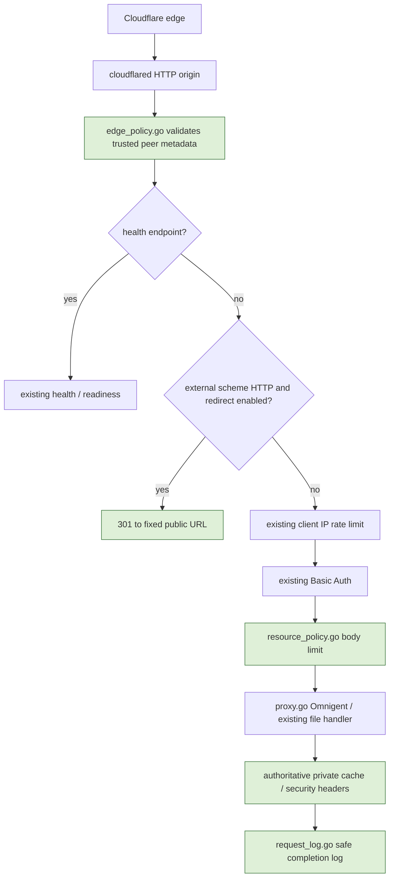

# Plan：可信 tunnel、HTTPS redirect 與私人入口 hardening

## 目標與範圍

依使用者「可設定 301 HTTPS redirect、記錄 improvement 並先做可實作功能」要求，改善現有單站台 Go server。維持 Go `8081` → Omnigent `6767`；不重啟使用者現有服務、不修改 Cloudflare dashboard、不讀取 credential JSON／EAB／private keys，不申請憑證，不建立 Git repo，不增加 dependency。

這是 Core Code，涉及所有入口的信任、認證、header、cache、body 與 proxy 行為。保持預設相容性，新增欄位預設關閉；需逐段審查、直接 regression 與獨立 review。使用者已要求實作；部署與任何 Cloudflare mutation 仍另外授權。

## 流程

Log wrapper 包覆整個 handler，包含 redirect／401／429／health。Health 保持現有 loopback HTTP probe 契約，不強迫 redirect；無 body cap，回應設 no-store。應用路徑的 redirect 位於認證之前，避免對新 HTTP 訪客先發 Basic challenge。

## 新設定契約

CLI 使用 hyphen，Webfile 使用 underscore：

| Webfile | config field | 預設 | 契約 |
|---|---|---|---|
| `public_url https://omni.curl.rs` | `publicURL string` | 空 | 固定 HTTPS origin，無 userinfo／query／fragment／非 root path；不從 request Host 產生 redirect。 |
| `https_redirect on/off` | `httpsRedirect bool` | off | HTTP 應用路徑回 301，保留 path／query；需要 public_url。已是 HTTPS 不 redirect。 |
| `trusted_proxies <CIDR...>` | `trustedProxies string` | 空 | Webfile 空白分隔，存成 CLI-compatible comma string；無信任範圍就忽略 forwarded metadata。 |
| `client_ip_header CF-Connecting-IP` | `clientIPHeader string` | 空 | 僅允許 CF-Connecting-IP 或 X-Real-IP；需 trusted_proxies；只接受單一合法 IP。 |
| `private_cache on/off` | `privateCache bool` | off | 應用 response 覆寫為 private, no-store，移除 public/shared TTL；不能清除既有 edge cache。 |
| `hsts_max_age <seconds>` | `hstsMaxAge int64` | 0 | 0 disabled；只在判定 HTTPS 的 response 設定 max-age，不自動 includeSubDomains/preload。 |
| `frame_options SAMEORIGIN/DENY/off` | `frameOptions string` | 空 | 保留相同 origin iframe 或禁止 frame；off disabled。 |
| `referrer_policy strict-origin-when-cross-origin/no-referrer/off` | `referrerPolicy string` | 空 | 明確枚舉，禁止 header injection。 |
| `max_body_bytes <integer>` | `maxBodyBytes int64` | 0 | 0 disabled；驗證非負。正式 upload policy 未確認，production 保持 0。 |
| `access_log on/off` | `accessLog bool` | off | 自產 request ID；只記 method、status、duration、origin_scheme、completion 等非秘密欄位。origin_scheme 僅代表 Go transport，不代表 Cloudflare 外部 HTTPS。 |

TLS state優先於 forwarded scheme。可信 HTTP peer 可使用單一 `X-Forwarded-Proto: http/https`；重複、逗號串列或不合法 metadata 不採用，維持 origin-derived scheme／peer IP。不支援盲目信任 X-Forwarded-For chain。

## Ownership 與介面

Integration owner 修改 `main.go` config fields／validation、`config.go` parser、`server.go` middleware 與 limiter、`proxy.go` forwarding／body-error handling，以及 production profile／既有 regression。

新 `edge_policy.go` 提供：
- `newEdgePolicy(c config) (*edgePolicy, error)`，驗證新增 edge/header 設定。
- `(*edgePolicy).wrap(next http.Handler) http.Handler`，metadata、301、health exception、authoritative response policy。
- `requestClientIP(*http.Request) string`、`requestScheme(*http.Request) string`、`requestPublicHost(*http.Request) string`，context metadata／安全 fallback。
- `enforcePrivateCache(http.Header)`，供 proxy ModifyResponse 清除 upstream public policy。

新 `resource_policy.go` 提供 `limitRequestBody(max int64, next http.Handler) http.Handler`、`proxyErrorStatus(error) int`。Body cap 放在 auth 之內、proxy 之前；未知長度使用 streaming MaxBytesReader，不預先完整 buffer，實際讀取超限時映射為 413。handler 不讀 body 或 upstream 提早回應時，不預讀完整 body 作驗證。超限不讓 backend 變 unhealthy，不 retry。未知長度可能已轉送部分內容，後端仍須正確處理不完整 upload，不能宣稱無副作用。

新 `request_log.go` 提供 `observeRequests(enabled bool, next http.Handler) http.Handler`、`requestID(*http.Request) string`。不信任 incoming ID；不記錄 raw path／query／Authorization／Cookie／body／username。保留 Flush／Hijack 或 Unwrap、串流與 WS semantics；completion／panic path 不誤記成功。不做無上限 log queue。

## Verification

1. 未受信任 peer 偽造 HTTPS/IP 無效；可信 CF HTTPS 不 redirect，HTTP 回 canonical 301；path/query 不丟失，惡意 Host 不控制 Location。直接 TLS不被header降級。
2. 兩個可信 client IP 的 limiter bucket 分開；upstream收到 verified IP／scheme、canonical external host，沒有 edge Authorization／spoofed forwarding headers。
3. Basic 401 與 authenticated proxy 200 皆有 private no-store；backend public cache policy不能覆寫。HTTPS才有HSTS，frame/referrer政策一致。
4. Body within-limit、已知超限、未知長度超限；413，不大幅buffer、不retry、不改backendhealth。0保持相容。
5. Request log不含秘密／path／query，ID有界、自產；HTTP/WS/flush/panic lifecycle兼容。
6. Default舊profile及HTTP2/TLS/HTTP3/WS/WSS/ACME tests回歸；CLI覆寫Webfile及不合法directive驗證。
7. `mise exec go@1.27.1 -- go test -race -count=1 -cover ./...`、`go vet ./...`、Python工具tests、獨立review。
8. 重建trimpath/CGO0 production binary、build info／SHA256，隔離loopback port smoke，只停止自有測試程序。不在正式8081搶port。

## Production profile 與 rollout

保留 loopback8081、Omnigent6767、auth env。明確啟用 public_url、301、loopback trusted_proxies、CF-Connecting-IP、private cache、HSTS86400、SAMEORIGIN、strict-origin-when-cross-origin、access log。body cap0仍待upload需求；不加CSP enforcement或取消timeout。

新source/config不會改變現有Go程序。使用者需安排部署，既有WS可能中斷。回復原binary/profile備份，不更動Omnigent。301／HSTS的browser狀態與edge cache不能以還原binary立刻消除，須預先了解影響。

Go301只作用於到達origin的request。Cloudflare已有cacheHIT可以繞過它，仍需edgeHTTPS規則與cachebypass／授權purge。Always Use HTTPS的zone-wide影響，與只限omni.curl.rs的Redirect Rule分開說明。改善實作與外部部署核取項目見 [improvement.md](improvement.md)。

## 完成狀態

- [x] 原始碼與設定契約完成。
- [x] 回歸、獨立 review 與 artifact smoke 完成。
- [x] 文件及 improvement 勾選同步。
- [ ] 正式Go部署、公網與Cloudflare操作驗收，本次不自動執行。

驗證證據：[2026-10-09-hardening.json](../reports/2026-10-09-hardening.json)。Go race／vet 通過，statement coverage 80.3%，Python 12 tests 通過。Review 指出的 WS 101 policy／request-ID 缺口已修正，再以完整 newApp stack 驗證真實 WS frame、103 Early Hints 與 trailer。新 binary 約 9.88 MiB；只原子替換磁碟 artifact，不重啟使用者程序。
