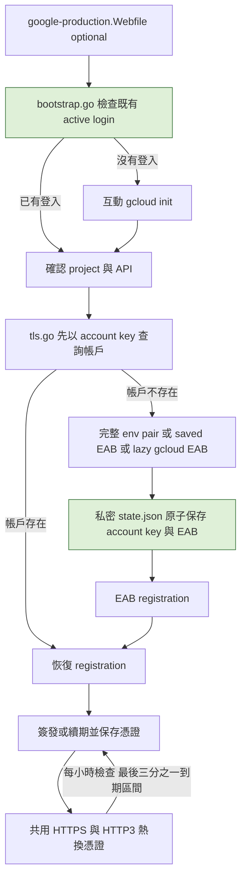

# Production build 與私密 EAB 保存

## 目標與範圍

交付 macOS arm64 production binary，支援 `omni.curl.rs` 的固定 Cloudflare Tunnel 情境，另保留獨立 Google HTTPS／HTTP3 profile。Google 模式重用本機已存在的 gcloud active login，不重新 init；把產生的完整 EAB 以及 ACME account／certificate 保存於私密 cache，供註冊中斷後恢復、重啟與自動續期使用。

本次可修改 `tls.go`、`bootstrap.go`、直接影響的測試、production 設定、文件與安全排除規則。其他 middleware、proxy、rate limit、QUIC 實作不變，不新增 dependency。真實 cloud mutation、正式 TLS 簽發與對外部署必須另外確認範圍及授權。

### 固定驗收決策

- 使用者選擇 Cloudflare edge 為主；正確路徑是 `cloudflared tunnel --protocol http2` 將 `omni.curl.rs` 導向 Go `http://127.0.0.1:8081`，再由 Go proxy 到既有 Omnigent `http://127.0.0.1:6767`。
- 此 profile 不啟用 Go TLS／HTTP3、不產生 Google EAB、不做 HTTP→HTTPS redirect。Google 另留設定與本機 fake ACME 測試，不把 edge 憑證視為 Google 憑證。
- 較早版本把 `6767` 當成 Go listener，並將其既有 listener 誤判為阻塞，這項結論已被取代。`6767` 是 Omnigent upstream，必須保持運作，禁止依舊指示停止或替換它。

## 改動分類

這是 Core Code 修改，涉及 ACME credential schema 與註冊恢復，不是單純 build flag。範圍涵蓋全部 HTTPS 啟動與續期，失敗可能使 TLS 無法提供服務；因此需直接回歸、私密檔案安全檢查與獨立 review。

## 流程

## 保存與安全契約

- `cert_dir/state.json` 使用既有同目錄暫存檔、sync、rename 與 `0600` 機制。新目錄 `0700`；每個目錄只供一個程序使用。
- EAB 僅在新 registration 需要時取得。完整環境變數 pair 優先，再用 private cache，再依設定呼叫 Google。只有一個 env 值時拒絕，不默默混合其他來源。
- 在 registration 前保存 account key 與完整 EAB；寫入失敗不得繼續註冊。舊 state 沒有 EAB 仍可讀。
- 已註冊的重啟與續期只依賴保存的 account key／registration，不需要重新產生 EAB 或 gcloud。
- Google EAB 是短效、單次註冊憑證。保留 EAB 不代表可以再次註冊，不能替代 account key；恢復時先 ResolveAccountByKey。
- 本次使用者要求覆寫先前「EAB 不寫入 cache」決策。私密保存由 server 執行；agent 不讀取真實 EAB／private keys，不寫入公開 config、log、測試結果、Serena memory 或公開檔案 root。
- `config/production.Webfile` 為 HTTP-only tunnel profile；`config/google-production.Webfile` 另含本機 ACME contact。兩者權限 `0600`，從 Git／Serena 排除。公開範本分別為 `config/cloudflared-example.Webfile`、`config/production-example.Webfile`。

## 驗證

1. 本機 fake ACME 註冊、保存、重啟、憑證續期及帳戶 key 恢復，沒有再次取得 EAB。
2. partial／missing credential、cache write failure、不正確 cache／EAB 與秘密錯誤輸出檢查。
3. gcloud mock：既有 active login 跳過 init；沒有登入仍使用原本互動流程，保留 project／API 確認與取消。
4. Production 範本要求密碼及 TOS 確認；compiled binary 以明確 CLI override 在 loopback 執行 Basic Auth、rate、health/readiness 與 SIGTERM smoke test，不做真實 cloud operation。
5. Go race、vet、build；檢查 private config mode、binary build info、SHA-256、文件連結及獨立 review。

## 產物與進度

- 最終 binary 已重編譯，`CGO_ENABLED=0`、`-trimpath`、`-buildvcs=false`、`-ldflags='-s -w'`；產物約 9.80 MiB，checksum 見 `dist/SHA256SUMS`。
- EAB／登入重用實作完成；獨立 review 後修正標準 Base64 HMAC 到 URL-safe 格式的正規化，並驗證 env credential 優先於 saved credential。
- `go test -race -count=1 -cover ./...` 通過，coverage 78.6%；`go vet ./...` 通過。Python 測試工具 10 項通過。
- compiled binary 的隔離 HTTP／Basic Auth／健康端點／rate limit smoke，以及 marker reverse proxy／WS echo／自有程序 SIGTERM cleanup 通過。
- 早期 cloudflared ingress 的 CLI validate 通過，當時未改使用者設定。更新後的 `~/.cloudflared/config.yml` 也已通過最終 ingress CLI validate；這只驗證磁碟設定，沒有 reload／restart 或公網 HTTPS／WSS 驗證。本機 compiled Go binary 在 `127.0.0.1:8081` proxy 到 Omnigent `127.0.0.1:6767` 的 health/readiness、auth、首頁 body match 與 SIGTERM 檢查通過，Omnigent 保持健康。因 `8080` 上的既有 socket 導致 Go bind failure，本次改用 `8081`，不調查或停止相關服務。使用者須先啟動 Go，再重啟自己的 tunnel，重啟可能造成短暫中斷。回復時還原修改前的備份，再重啟 tunnel。完整路由紀錄見 [2026-10-09-origin-routing.json](../reports/2026-10-09-origin-routing.json)。
- 真實 API／EAB／Google 憑證簽發及 public TCP 80 可達性未執行／未驗證；未保存任何真實 EAB。

## 風險與回復

- EAB 與私鑰一併備份是私密資料備份；備份目的地需加密及存取控制，不放入 repo／public root。
- 保留 matching account key、網域、email、CA directory，不能刪除 cache 來重試。
- 舊 binary 能忽略 JSON 中的新增欄位，但可能在再次保存時移除 EAB。回復前備份 cache，保持 identity 相同；不能把 EAB 留存當作跨版本 account key 復原保證。
- 本機已有 gcloud login 只代表 credentials metadata 存在，不保證 token、IAM 權限或公開 DNS／HTTP-01 路由有效。
