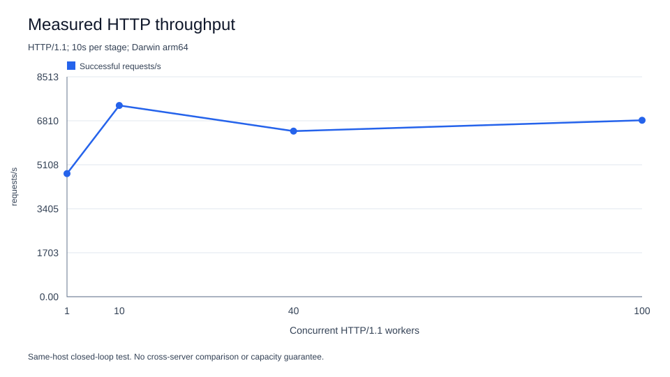
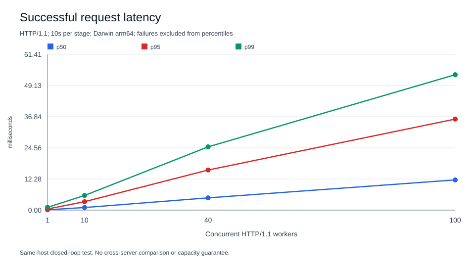
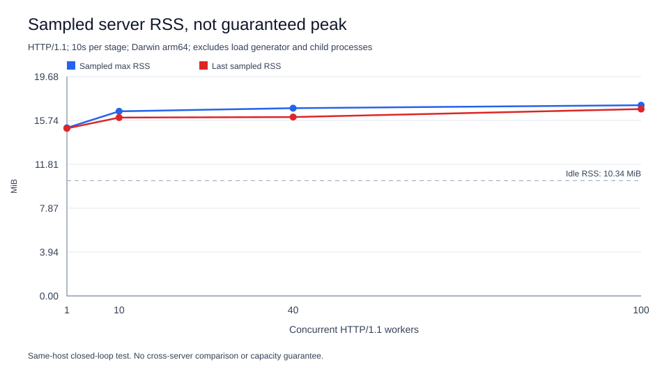
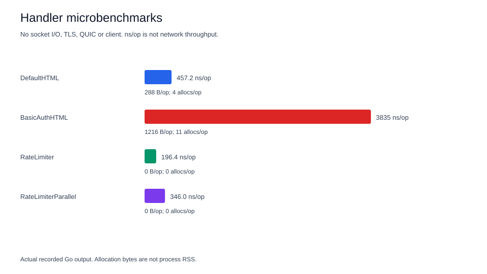

# 目前負載測試結果

報告日期採 UTC：2026-10-08。實際 HTTP 測試時間為 **2026-10-08 16:14:57 至 16:15:37 UTC**，約 40.3 秒；臺灣時間為 2026-10-09 00:14:57 至 00:15:37。

## 結論

本次只量測 HTTP/1.1 內建首頁。在同一台 Apple M4 上，四階段 concurrency 1、10、40、100 各持續 10 秒，共 **254,390 次成功請求、0 次錯誤**。server 閒置 RSS **10.34 MiB**，測試期間取樣的最大 RSS **17.11 MiB**。

這些數字不是 production 容量上限。Client 與 server 共用主機，Python client 可能成為瓶頸；本次沒有測 TLS、HTTP/3、proxy、檔案服務或 WS 長連線，也沒有跨產品比較、長時間 soak 或故障注入。不能據此宣稱比 Caddy、Nginx、Ferron 或 Pingora 更快、更省記憶體或更穩定。

## 環境與方法

| 項目 | 本次設定 |
|---|---|
| 主機 | Apple M4、10 logical CPUs、Darwin arm64 |
| Go | `go version go1.27.1 darwin/arm64` |
| Client | Python 3.14.8，標準函式庫 `http.client` |
| Server build | 一般 `go build`，沒有 race instrumentation |
| Server flags | `-http 127.0.0.1:58983 -rate 0` |
| Workload | `GET /`，內建 HTML，期望 HTTP 200 |
| Protocol | HTTP/1.1，每個 worker 使用一條 keep-alive connection |
| 模型 | closed-loop：前一請求完成後才送下一請求 |
| 併發／時間 | 1、10、40、100；各 10 秒，依序執行，同一 server 程序 |
| 記憶體 | `ps` 每 0.5 秒取樣 server PID RSS，不含 client／子程序 |
| Runtime 設定 | `GOGC`、`GOMEMLIMIT`、`GOMAXPROCS` 未指定，使用 Go 預設 |
| 結束 | server 收到 SIGTERM，exit code 0 |

限流刻意設為 `0`，否則同一 peer IP 的預設 `10 req/s`、burst `20` 會讓大部分請求回 429，測到的是限流政策而不是這個 workload 的 throughput。沒有 Basic Auth、upstream、root、HTTPS、HTTP/3 或 WebSocket。啟動後先確認健康端點，再進行測試。

每次請求量測至回應 body 讀完的時間；percentile 使用成功請求的 nearest-rank 值。每階段最後一批請求可能在設定期限後完成，因此 RPS 使用實際 elapsed time，而不是固定除以 10。錯誤欄位包含非 200 或 request exception；本次各階段都為 0。

## HTTP 數據

以下數值四捨五入；完整精度、status counts、RSS samples 見 [http-load.json](data/http-load.json)。

| Concurrency | 成功請求 | req/s | 錯誤 | p50 ms | p95 ms | p99 ms | 最大延遲 ms | 取樣最大 RSS MiB | 最後取樣 RSS MiB |
|---:|---:|---:|---:|---:|---:|---:|---:|---:|---:|
| 1 | 47,690 | 4,765.83 | 0 | 0.142 | 0.463 | 1.108 | 24.121 | 15.08 | 15.03 |
| 10 | 74,041 | 7,402.40 | 0 | 1.035 | 3.336 | 5.791 | 41.489 | 16.56 | 16.00 |
| 40 | 64,165 | 6,410.64 | 0 | 4.848 | 15.814 | 24.959 | 82.846 | 16.84 | 16.05 |
| 100 | 68,494 | 6,830.01 | 0 | 11.916 | 35.907 | 53.399 | 125.105 | 17.11 | 16.77 |

併發提高時 throughput 沒有持續提高，而 latency 上升。這可能包含 client threads、Python runtime、同機 CPU 競爭與排程的影響，不能只靠本次數據把瓶頸歸因到 server。

### Throughput



### Latency



### Memory



RSS 是程序 resident pages，不是 Go live heap，也不是配置次數。0.5 秒取樣可能漏掉瞬間尖峰；階段間沒有重啟或清空 heap。圖中的最後 RSS 不是完整 GC 後的基線，也不是 memory leak 檢測結果。

## Handler microbenchmark

另以 Go benchmark 量測 handler／limiter 的程序內開銷，不包含 socket I/O、TLS、QUIC 或 client。這不是網路 throughput。

```sh
mise exec go@1.27.1 -- go test -run '^$' -bench . -benchmem -benchtime=1s -count=1 ./...
```

| Benchmark | ns/op | B/op | allocs/op |
|---|---:|---:|---:|
| DefaultHTML | 457.2 | 288 | 4 |
| BasicAuthHTML | 3,835 | 1,216 | 11 |
| RateLimiter | 196.4 | 0 | 0 |
| RateLimiterParallel | 346.0 | 0 | 0 |



原始輸出：[handler-bench.txt](data/handler-bench.txt)。`B/op` 與 `allocs/op` 是每次操作的 allocation 統計，不可當成 server RSS。這是單次 benchmark，沒有多次取樣信賴區間。

## 重跑與來源

測試工具與完整重跑流程見 [scripts/README.md](../scripts/README.md)。本次使用：

```sh
mise exec go@1.27.1 -- go build -o <temporary-binary> .
<temporary-binary> -http 127.0.0.1:58983 -rate 0
mise exec -- python scripts/load_test.py \
  --url http://127.0.0.1:58983/ \
  --concurrency 1,10,40,100 --duration 10 \
  --server-pid <server-pid> --output reports/data/http-load.json
mise exec -- python scripts/render_charts.py reports/data/http-load.json \
  --bench reports/data/handler-bench.txt --output-dir reports/charts
```

尖括號是本次暫存 binary 與 PID 的佔位符，不是可直接執行的 shell 語法。重跑時用新的 output 檔與 chart directory；工具拒絕覆蓋既有結果。Load generator 預設只允許 loopback，避免誤打外部服務。

來源紀錄：[build-metadata.json](data/build-metadata.json)，包含 Go version、build command、server flags、程式來源／go.mod／load script SHA-256、binary SHA-256，以及 shutdown 結果。不是 Git commit 證明；工作目錄目前不是 Git repository。

Charts 由原始 JSON 與 benchmark 文字生成，沒有填補未測量的數據。SVG 含 title、description 與可縮放向量圖，可直接在支援 SVG 的 Markdown viewer 或瀏覽器檢視。

## 與其他產品的比較

| 對象 | 比較前需統一的條件 |
|---|---|
| [Caddy](https://caddyserver.com/docs/) | Go server，含自動 HTTPS；需統一 TLS、認證、logging、壓縮與 proxy 設定 |
| [Nginx](https://nginx.org/en/docs/dev/development_guide.html) | C／事件驅動架構；需統一 worker 數、connection limits、keep-alive 與完整程序樹 RSS |
| [Ferron](https://github.com/ferronweb/ferron) | Rust web server；需固定版本及同樣 static／proxy／TLS workload |
| [Pingora](https://github.com/cloudflare/pingora) | Rust proxy framework；先建立等價 proxy application，不把框架與完整 Web server 直接相比 |

「memory safe」表示一類記憶體存取錯誤的防護，與「節省 RAM」是不同問題。使用 Go、功能較少或 binary 單一，都不能證明 RSS 更低或延遲更小。

後續比較至少需要另一台 load generator、多次測試、相同回應 body／headers／TLS／限流政策，分別量測 idle、keep-alive、proxy 與大量 WS 長連線的程序樹 RSS。穩定性需追加長時間 soak、upstream down／recover、CA 暫時不可用、續期、shutdown／restart 與 FD／connection 洩漏檢查。這些項目本次**尚未完成**。

## 本次驗證狀態

- `go test -race -count=1 -cover ./...` 通過，statement coverage **78.2%**，包含六份 Webfile 範例。
- `go vet ./...` 通過；正常 build 與 README HTTP 設定 smoke test 通過，首頁／health／readiness 都回 200，SIGTERM exit code 0。
- Python 工具四項 unittest 通過，包括實際 loopback 請求與 SVG XML／escaping。
- 64 個文件相對連結、code fences、四張 SVG、原始數據與測試 build 的來源 SHA-256 已核對；圖表也實際開啟檢視。
- 本機 fake ACME、TLS／HTTP/2／QUIC、WS／WSS 是功能測試，不是本報告的壓力測試。
- 未執行真實 Google 登入、API mutation 或正式憑證簽發，未測競品效能。官方 SDK archive 解壓測試已在本次開發前段另外執行；一般測試未指定 archive 時會跳過。

## 後續版本變更

本次 production build 與 EAB 持久化／既有 gcloud 登入重用是測試完成後的改動，見 [production-eab.md](../plan/production-eab.md)。本報告與 `data/build-metadata.json` 保留原測試來源、binary hash 及原始資料，不更新成新版本。此次 production artifact 尚未重跑這組負載，不能把本報告當作新 binary 的效能驗證。
